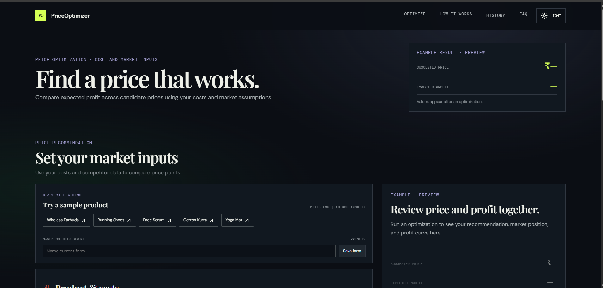
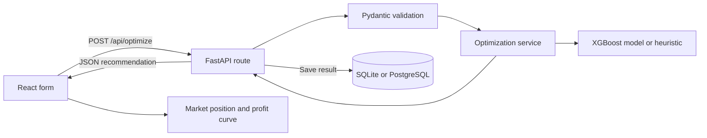

# PriceOptimizer

PriceOptimizer helps a seller estimate a profitable selling price for a product. Enter the unit cost and either provide competitor prices or let the app simulate them. The app evaluates candidate prices, estimates demand and expected profit, and displays the recommended price with a profit curve and market context.

It recommends a **price for a product**; it does not select a product to sell.



## What the app does

- Accepts product cost, per-unit costs, a markup range, stock, category, and optional market assumptions.
- Uses supplied competitor prices or generates sample competitor prices.
- Evaluates many candidate prices and recommends the candidate with the highest expected profit.
- Shows expected profit, profit per unit, markup, net margin, estimated units, competitor position, and the profit curve.
- Saves each recommendation to a SQL database so users can review history and compare runs.
- Uses a trained XGBoost demand model when the model files load successfully and a heuristic fallback otherwise.

## How a price is recommended

1. **Validate the inputs.** The FastAPI request schema checks cost, per-unit costs, markup range, category, month, rating, ad spend, stock, competitor prices, product name, and quality value.
2. **Choose competitor data.** If competitor prices are provided, those prices are used. Otherwise, the service generates a sample set around 1.5 times the unit cost using the requested competitor count.
3. **Build the candidate price range.** The minimum and maximum markup percentages are applied to unit cost. For example, a ₹100 cost with a 5%–80% markup range produces candidate prices from ₹105 to ₹180.
4. **Estimate demand for each candidate.** The XGBoost model receives each candidate price along with cost, competitor minimum/median/maximum, price position, category, month, rating, and ad spend. It predicts log demand; the app converts that prediction back to an estimated unit count.
5. **Calculate expected profit and choose a price.** For each candidate, per-unit profit is `max(0, price − unit cost − other per-unit costs)`. Expected profit is per-unit profit multiplied by estimated demand. The candidate with the highest expected profit is selected. If stock is provided, the displayed expected units are capped at available stock.
6. **Use the fallback if needed.** If the XGBoost model is missing or cannot load, the service evaluates prices with a heuristic demand estimate based on the competitor price range. The response identifies the method used.

The trained model uses the feature order recorded in `ml-model/feature_columns.json`. Keep that file in sync with the training and inference code when retraining the model. The `quality` field is validated and saved as metadata only; it does not change demand or pricing.

### Markup and margin

- **Markup** is `(selling price − unit cost) ÷ unit cost`.
- **Net margin** is `(selling price − unit cost − other per-unit costs) ÷ selling price`.

These measures use different denominators, so their percentages are not interchangeable.

## Project structure

```text
price optimiser/
├── backend/
│   ├── app/
│   │   ├── api/
│   │   │   ├── deps.py             # Database/optimizer dependencies
│   │   │   ├── optimize.py         # Price recommendation endpoint
│   │   │   ├── utils.py            # Sample, sort, and search endpoints
│   │   │   ├── history.py          # History, statistics, and products endpoints
│   │   │   └── health.py           # Health and admin status endpoints
│   │   ├── core/config.py          # Environment-based settings
│   │   ├── database/db.py          # SQLAlchemy engine, Base, and sessions
│   │   ├── models/product.py       # Optimization history model
│   │   ├── services/
│   │   │   ├── optimization_service.py # Request-to-optimizer orchestration
│   │   │   ├── xgb_optimizer.py        # XGBoost and heuristic price search
│   │   │   └── price_optimizer.py      # Sorting, searching, and sample data
│   │   ├── main.py                 # FastAPI app, startup, errors, and SPA serving
│   │   └── schemas.py              # Pydantic request/response schemas
│   ├── migrations/                 # Alembic schema history
│   ├── alembic.ini                 # Alembic configuration
│   └── requirements.txt            # Pinned Python dependencies
├── frontend/
│   ├── src/
│   │   ├── api/                    # Calls to the backend API
│   │   ├── components/             # Form, results, charts, history, and navigation
│   │   ├── hooks/                  # Optimizer and saved-preset state
│   │   ├── data/                   # Example product presets
│   │   ├── utils/                  # CSV report and browser preset helpers
│   │   ├── App.jsx                 # Main page composition
│   │   └── styles.css              # App theme and responsive styles
│   ├── vite.config.js              # Dev server and API proxy
│   └── package.json                # Frontend scripts and dependencies
├── ml-model/
│   ├── train_xgb.py                # Train and save the XGBoost model
│   ├── train_xgboost.py            # Backward-compatible training entry point
│   ├── data_cleaning.py            # Prepare the training data
│   ├── visualize_xgboost.py        # Model visualization utility
│   ├── xgb_model.json              # Trained model used by the backend
│   ├── feature_columns.json        # Model input feature contract
│   └── *.csv                       # Source and cleaned training datasets
├── tests/
│   ├── golden/                     # Captured API contract examples
│   ├── test_api.py                 # FastAPI route and parity tests
│   ├── test_schemas.py             # Request validation tests
│   └── test_fastapi_skeleton.py    # Settings, database, and model checks
├── docs/
│   ├── architecture.md             # Link to this README's architecture walkthrough
│   └── images/                     # README screenshots
├── docker/Dockerfile               # Multi-stage frontend/backend image
├── render.yaml                     # Render build and start configuration
└── .env.example                    # Local environment variable template
```

## Application flow



The optimizer is loaded once when the FastAPI application starts and stored on `app.state`. Routes that use the optimizer or database are synchronous so FastAPI runs their blocking work in its thread pool. SQLAlchemy uses synchronous sessions, and Alembic manages schema changes.

## API endpoints

| Method | Endpoint | Purpose |
|---|---|---|
| `POST` | `/api/optimize` | Validate inputs, recommend a price, and save the result. |
| `POST` | `/api/generate-sample` | Generate competitor prices for demonstrations. |
| `POST` | `/api/sort` | Sort up to 100,000 numeric prices. |
| `POST` | `/api/search` | Search a sorted price list. |
| `GET` | `/api/health` | Check database connectivity. |
| `GET` | `/api/history` | List saved recommendations; accepts `limit` and `product_id`. |
| `GET` | `/api/stats` | Return total recommendations and average expected profit. |
| `GET` | `/api/products` | List product IDs and recommendation counts. |
| `GET` | `/admin/status` | Return database status as JSON; requires a Bearer token. |

Interactive API documentation is available at `/docs` in development. `GET /api/optimize` endpoint help was removed; use the OpenAPI page instead. Validation errors return HTTP 400 with a `success: false` response and a `fields` object. Unexpected server errors return a generic message and an error ID.

## Run locally

Use Python 3.11 and Node.js 20 or newer. From the repository root, create and activate a virtual environment, install Python dependencies, and create the local environment file:

```powershell
py -3.11 -m venv .venv
.\.venv\Scripts\Activate.ps1
python -m pip install -r backend\requirements.txt
Copy-Item .env.example .env
```

Set `DATABASE_URL`, `SECRET_KEY`, `ADMIN_TOKEN`, `ENV`, and optionally `ENABLE_DOCS` in `.env`. The default database URL is `sqlite:///./instance/local.db`, resolved relative to the backend working directory.

### Database setup

For the existing database created by the Flask version, run these commands from `backend` once to mark the original schema and apply the later metadata migration:

```powershell
cd backend
python -m alembic stamp 20261102_0001
python -m alembic upgrade head
```

For a new, empty database, skip the stamp and run only:

```powershell
cd backend
python -m alembic upgrade head
```

Use `alembic stamp head` only if the database already has every column in the current model. Stamping records migration state without creating or altering tables.

### Start the services

From `backend`, run FastAPI:

```powershell
python -m uvicorn app.main:app --reload --port 8000
```

Alternatively, `python app/main.py` starts the API without auto-reload. In another terminal, from `frontend`, start Vite:

```powershell
cd frontend
npm ci
npm run dev
```

Open `http://localhost:3000`. Vite proxies `/api` to FastAPI on port 8000. The API docs are at `http://localhost:8000/docs`.

## Configuration

| Variable | Purpose | Default |
|---|---|---|
| `DATABASE_URL` | SQLAlchemy connection string. SQLite is used locally; PostgreSQL URLs use Psycopg. | `sqlite:///./instance/local.db` |
| `SECRET_KEY` | Application secret reserved for runtime configuration. | Unset |
| `ENV` | Runtime environment used to choose the API docs default. | `development` |
| `ADMIN_TOKEN` | Bearer token checked by `/admin/status`. | Unset |
| `ENABLE_DOCS` | Explicitly enable or disable `/docs`. | Enabled outside production |
| `PORT` | Port used when starting the API directly. | `8000` locally |

## Tests and model training

From the repository root with the virtual environment active:

```powershell
python -m pytest tests -v
cd frontend
npm test
```

To retrain the model using the prepared dataset, run this from the repository root:

```powershell
python ml-model/train_xgb.py
```

Training writes `ml-model/xgb_model.json` and updates `ml-model/feature_columns.json`. Inference checks the saved feature order before loading the model; it falls back to the heuristic optimizer if the model is missing or incompatible.
